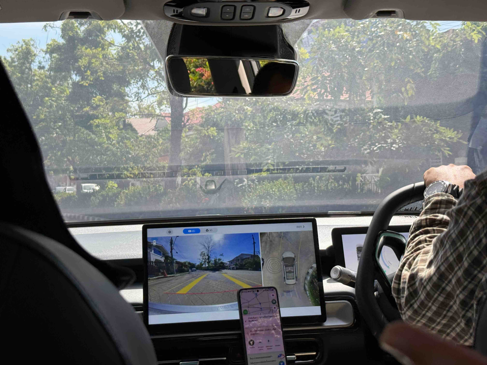
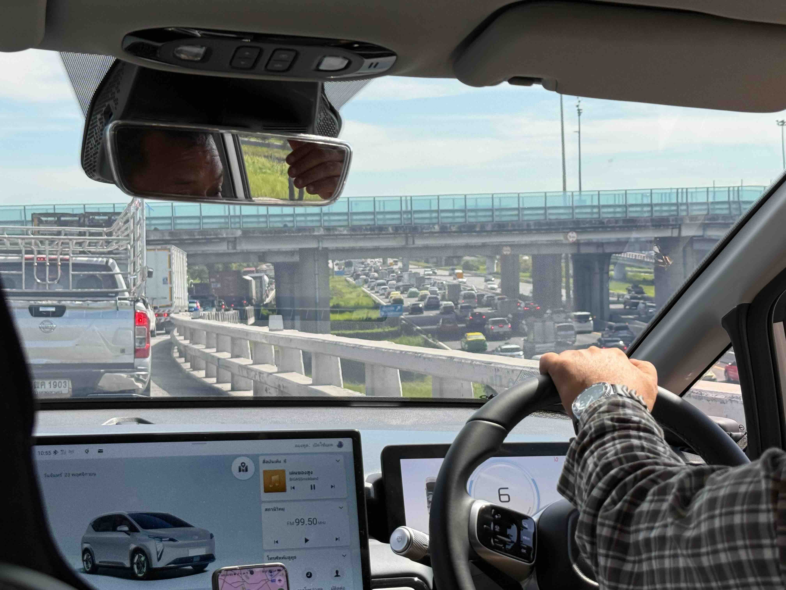
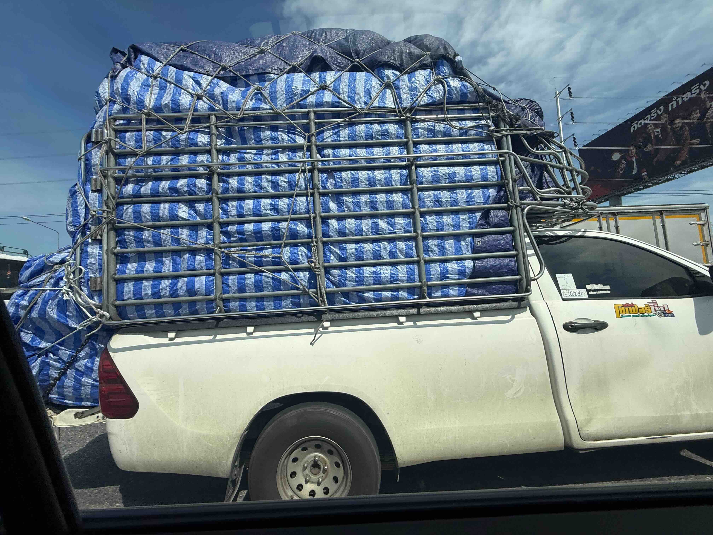
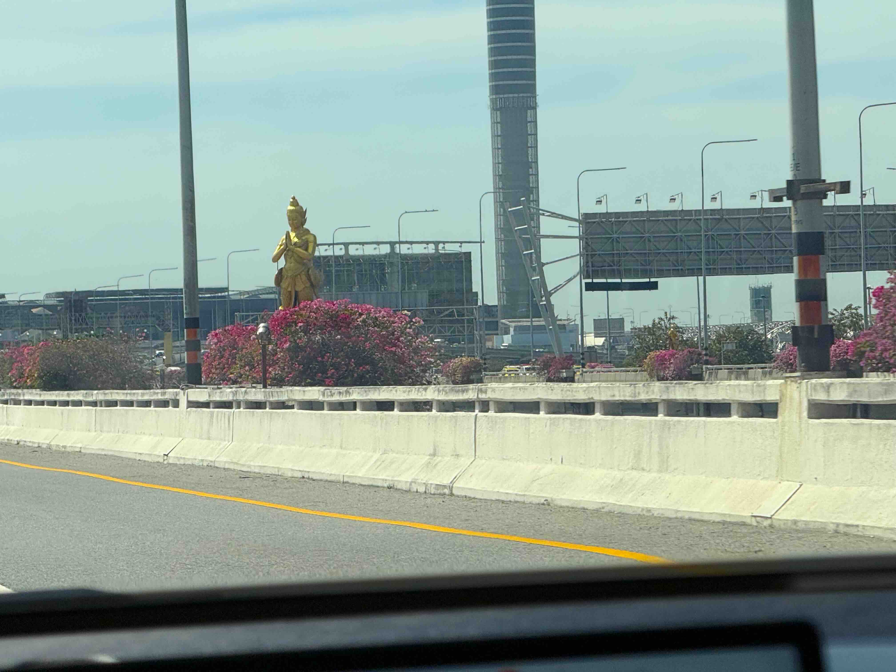
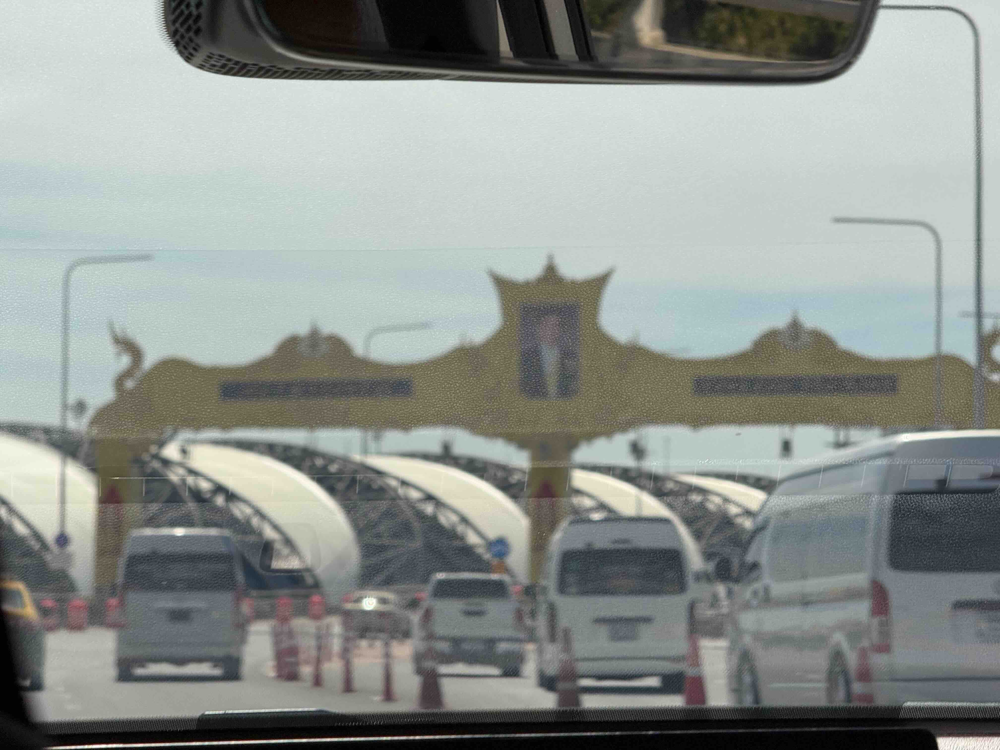
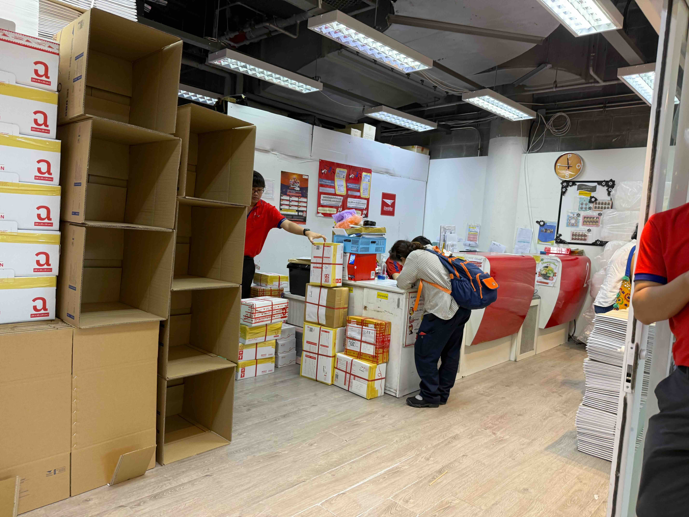
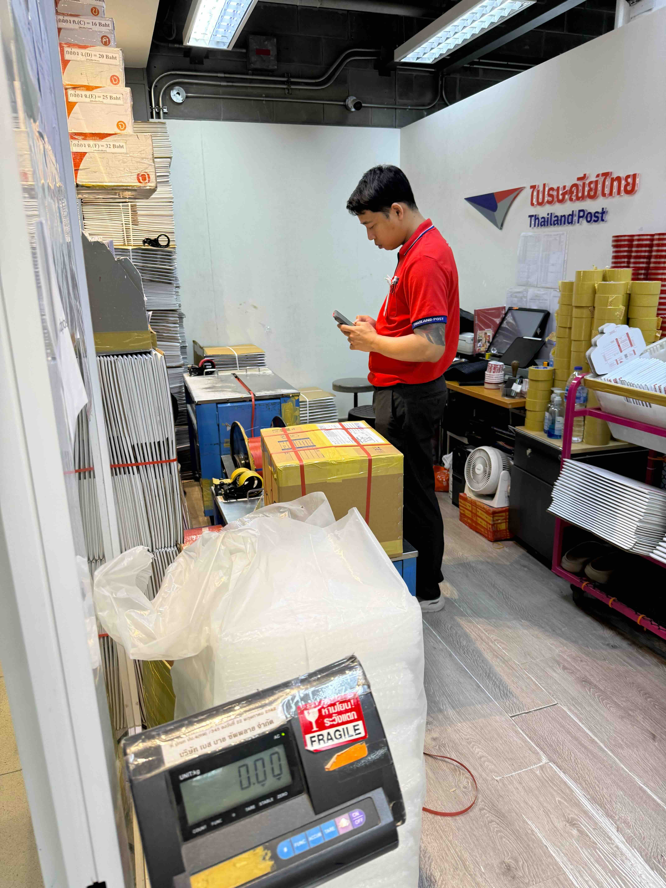
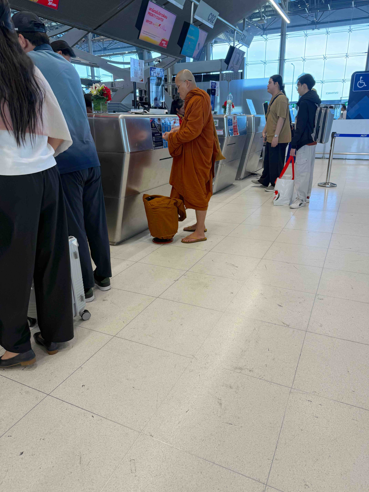
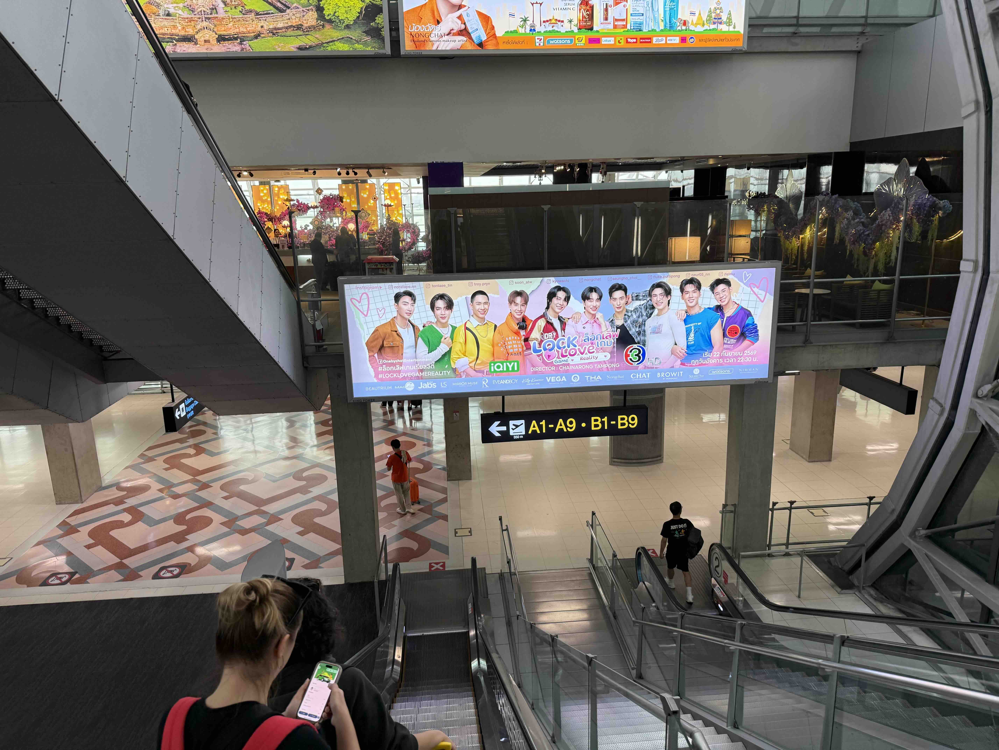
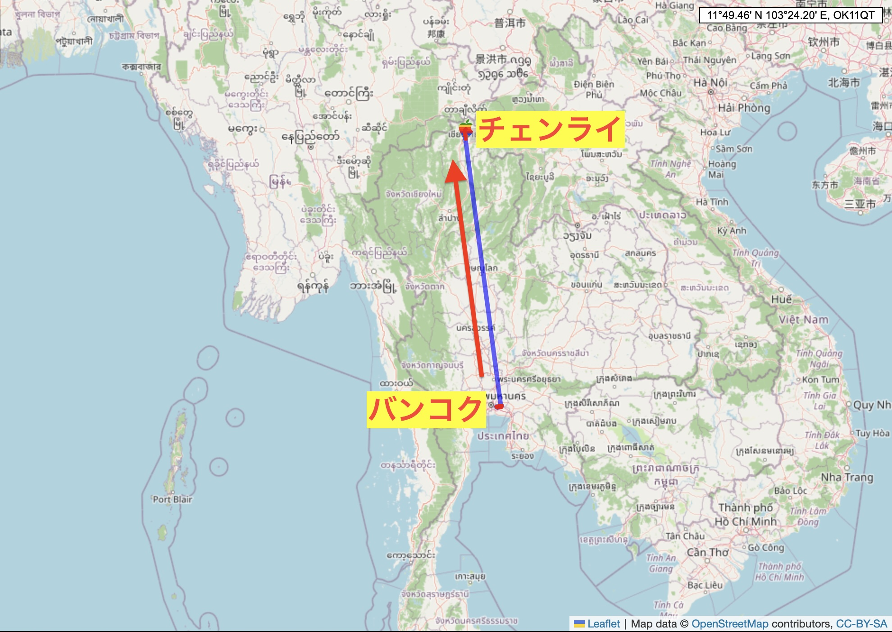

# 20261124_chiangrai

<html lang="ja" data-loaded="false" data-scrolled="false" data-spmenu="closed">
<head>

<meta charset="UTF-8">
<meta http-equiv="Content-Type" content="text/html; charset=UTF-8">
<meta http-equiv="X-UA-Compatible" content="IE=EmulateIE10" />
<meta http-equiv="X-UA-Compatible" content="IE=edge">

<meta name="viewport" content="width=device-width, initial-scale=1.0">

<!--ここから上はお決まりの定型文です-->

<!--ここからが表現の書式などを決めるcssという部分-->

<link href="https://cdnjs.cloudflare.com/ajax/libs/lightbox2/2.7.1/css/lightbox.css" rel="stylesheet">

</head>

<body>
    
<!--
    
<a href="https://peyng.github.io/restart/">前回までの記録</a>><a>今回2026,05,28</a>

-->

モバイル端末をお使いの場合は、画面を横向きにすると
背景画像の横方向がご覧頂けます。

<!--ここ上は、ほぼそのまま使います！-->

<!--QRコードの挿入例-->

 QR for Access

<marquee direction="left" scrollamount="20" width="30%">(^_^)/~alis</marquee>

<!--流れ文字の挿入例-->
<h1><marquee behavior="left">!!! 2026/11/24、タクシーで高速道路移動して、飛行機でタイ北部のチェンライまで  !!!</marquee></h1>

<!--ここから下が、本体部分-->

<h2>2026/Nov/23日、タクシーでスワンナプーム国際空港まで移動します</h2>

<h2>空港へ向かう高速道路は大渋滞</h2>

<h2>荷物満載のトラックはよく見ますが、高速に乗るときはしっかり梱包されてます</h2>

<h2>空港に向かう高速には、金色の仏像様が手を合わせています</h2>

<h2>空港間際に王室崇拝の金のゲート</h2>

<h2>手荷物の重量オーバーが出たので、空港内郵便局から別配送の手続き</h2>

<h2>しっかり梱包してもらいました</h2>

<h2>空港に来ると必ず見かけるお坊様</h2>

<h2>A4搭乗口まで、広い空港内を移動します</h2>

<h2>A4搭乗口の待合室に到着、日本人は居ません</h2>

<h2>機内搭乗</h2>

<h2>低層の雲はあっさり突き抜けます</h2>

<h2>上層の雲との間ほどを通常飛行でした</h2>

<h2>チェンライエリアに到着、周囲の山々がよく見えます</h2>

<h2>空港ロビーのお出迎えはお人形さん3体</h2>

<h2>ロビーを出ると飾り付けのオブジェがこんな感じ</h2>

<h2>この大きなお顔は1年以上健在ですね</h2>

<h2>空港を出ると見事な晴天</h2>

<h2>空港レーダードームも陽射しを浴びてクッキリ</h2>

<h2>タイ北部の山々が迫ります</h2>

<h2>タイのアマチュア無線モービル、コールサインは HS5XLE</h2>

<h2>山の上のお寺もクッキリ見えます</h2>

<h2>空港の側なので、高層マンションが立ち並びます</h2>

<h2>ちょっと街を外れると、田園地帯</h2>

<h2>剥き出しのギター抱えて、バイクで移動してます</h2>

<h2>幹線道路の検問所</h2>

<h2>北からの違法移民の取り締まりなので、北上方向はスルー、南下方向は渋滞中でした</h2>

<h2>お人形さん運搬中ですが、空気抜けばいいのに？</h2>

<h2>直進と右折を青にする、タイ特有の信号システム。対向車は止まってるので右折がスムーズ</h2>

<h2>山々が道路の先に迫ります</h2>

<h2>西陽を浴びるロータスで遅いお昼とお買い物</h2>

<h2>この日もフードコートでこれ</h2>

<h2>食器のシステムは独特で、綺麗に洗ったフォークやスプーンを左上の熱湯で消毒して使います</h2>

<h2>食べ終わったら、こちらに下げ膳するシステム</h2>

<h2>食後は広い店内でお買い物</h2>

<h2>道沿いのお花が西陽を浴びてニッコリ</h2>

<h2>田舎の交通量は少なくて、道が長ーく見えます</h2>

<h2>屋根上の鳩さん</h2>

<h2>ワンコもベロ出して暑そう</h2>

<h2>西の空が綺麗に色づきました</h2>

<h2>椰子の向こうにお月様</h2>

<h2>月齢13.7日、十三夜のお月様です</h2>

<h2>バンコクでタクシー乗ったら、客が日本人と分かって X-Japan 流してくれる気遣い運転手さん。さすが観光立国！</h2>

<iframe width="560" height="315" src="https://www.youtube.com/embed/uxFSREg6t_Y?si=FSF13DWFUKRxKlxj&autoplay=1&mute=1&loop=1&playlist=uxFSREg6t_Y" title="YouTube video player" frameborder="0" allow="accelerometer; autoplay; clipboard-write; encrypted-media; gyroscope; picture-in-picture" allowfullscreen></iframe>
    

<h2>今回の移動でタイの北端部まで来てます</h2>

<!--
<h2>カラオケの盛り上がりは絶好調</h2>

<iframe width="560" height="315" src="https://www.youtube.com/embed/ppqZmsheMTw?si=9aRPlRBRy2xuQZRI&autoplay=1&mute=1&loop=1&playlist=ppqZmsheMTw" title="YouTube video player" frameborder="0" allow="accelerometer; autoplay; clipboard-write; encrypted-media; gyroscope; picture-in-picture" allowfullscreen></iframe>
    

-->

<h2>Moon age</h2>
    <h2>
<a href="https://starwalk.space/ja/moon-calendar" target="_blank">Moon age Link</a>
</h2>

<h2>今日のBGMは、何も考えず｜深く息つくケルト音楽｜Relaxing Celtic Music｜癒しBGM　作業用BGM　リラックスBGM</h2>

<iframe width="560" height="315" src="https://www.youtube.com/embed/q92s8Ll3hz4?si=lFKwtED-W3RStY3P" title="YouTube video player" frameborder="0" allow="accelerometer; autoplay; clipboard-write; encrypted-media; gyroscope; picture-in-picture; web-share" referrerpolicy="strict-origin-when-cross-origin" allowfullscreen></iframe>
    

   
<h2>2026Nov24、タクシーで高速道路移動して、飛行機でタイ北部のチェンライまででした Thank you for reading this far.</h2>
<!--
     
<h2>
<a href="https://torokoid.github.io/Mashiko_himawari_3/" target="_blank">クリックでメニューページに戻ります</a>
</h2>
-->

   

<!-- hitwebcounter Code START -->
<a href="https://www.hitwebcounter.com" target="_blank">

you are visitor The numbers are cumulative for the Bangkok ＆ Utsunomiya series websites launched since 2025 August 1st.
</a>   

<!--本体はここまで-->
    

<!--画面に空白地帯を作って、背景が見えるようにしています-->

<!-- フッタ -->
<footer>

Copyright 2026/11/24 alis

</footer>

<!--HPにさまざまなJavaScriptを呼び込むための書式-->

    
    </body>
    
</html>
